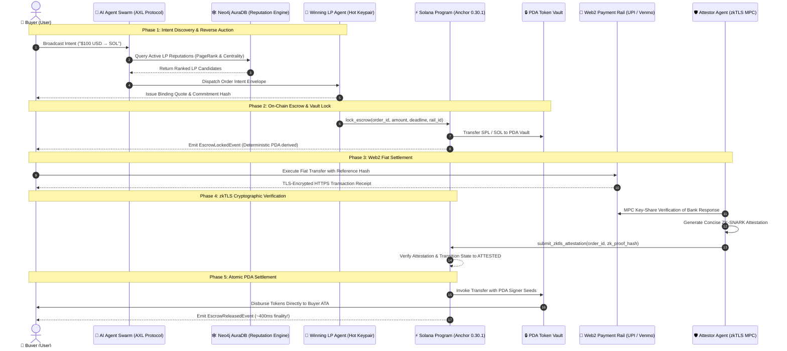

# Beanstick (BeanSol): Comprehensive Protocol Architecture & Solana Reference Specification

> **The Autonomous Fiat-to-Crypto Settlement Network on Solana.**  
> Sub-second finality. Zero custodians. Non-custodial PDA Escrows. zkTLS Cryptographic Verification.

---

## 1. Executive Summary & Core Value Proposition

Beanstick is a trustless, non-custodial fiat-to-crypto settlement protocol engineered specifically for the Solana blockchain. By synthesizing an autonomous **Agentic Swarm Protocol**, **zero-knowledge TLS verification (zkTLS)**, and **Solana Program Derived Addresses (PDAs)**, Beanstick enables retail and enterprise users to convert traditional fiat currencies (USD, INR, EUR, GBP) into on-chain liquidity (native SOL, SPL USDC, and PYUSD) in under a second.

Unlike centralized exchanges (CEXs) and custodial onramps:
* **No Custodial Intermediaries:** Funds are locked in deterministic, program-owned PDA vaults governed by an immutable finite-state machine (FSM).
* **True Sub-Second Settlement:** Exploiting Solana's 400ms slot times, funds arrive in the buyer's wallet in ~400ms following fiat attestation.
* **Predictable Micro-Fees:** Transactions cost less than \$0.0008 in compute fees, making micro-transactions economically viable.
* **Privacy-Preserving Verification:** Web2 bank receipts (UPI, Venmo, SEPA, Faster Payments) are verified via Multi-Party Computation (MPC) TLS sessions—zero bank logins or credentials leak on-chain.

---

## 2. End-to-End Protocol Lifecycle & Sequence Diagram

The diagram below illustrates the complete execution flow from intent broadcast to atomic on-chain settlement:



---

## 3. Canonical PDA Seed Derivation Formulas

Beanstick relies strictly on deterministic 32-byte Program Derived Addresses (PDAs). Every account is derived using static string prefixes and canonical little-endian byte encodings to guarantee account exclusivity and prevent collisions:

```
Program ID: Bean111111111111111111111111111111111111111
```

| Account Role | Derivation Seeds | Seeds Formula / Rust Byte Layout | Description |
| :--- | :--- | :--- | :--- |
| **Protocol Config** | `["config"]` | `[b"config"]` | Global configuration, authority key, protocol pause flag, and treasury accounts. |
| **LP Account** | `["lp", lp_authority]` | `[b"lp", lp_authority.key().as_ref()]` | Per-LP registry holding staked security bond, total volume, and performance scores. |
| **Escrow State** | `["escrow", order_id]` | `[b"escrow", order_id.to_le_bytes().as_ref()]` | Order escrow state machine, buyer pubkey, amount, deadline, and commitment hashes. |
| **Escrow Vault** | `["vault", escrow_pda]` | `[b"vault", escrow_pda.key().as_ref()]` | Program-owned SPL Token account holding escrowed collateral. |
| **Attestation** | `["attestation", escrow_pda]` | `[b"attestation", escrow_pda.key().as_ref()]` | Cryptographic proof payload, attestor signatures, and verification timestamps. |
| **Reputation Root** | `["reputation-root", epoch]` | `[b"reputation-root", epoch.to_le_bytes().as_ref()]` | Merkle root of Neo4j graph trust scores committed per epoch. |

### Canonical Derivation Implementation (TypeScript):
```typescript
import { PublicKey } from '@solana/web3.js';

export function getEscrowPda(orderId: bigint, programId: PublicKey): [PublicKey, number] {
  const orderBuf = Buffer.alloc(8);
  orderBuf.writeBigUInt64LE(orderId);
  return PublicKey.findProgramAddressSync([Buffer.from('escrow'), orderBuf], programId);
}

export function getVaultPda(escrowPda: PublicKey, programId: PublicKey): [PublicKey, number] {
  return PublicKey.findProgramAddressSync([Buffer.from('vault'), escrowPda.toBuffer()], programId);
}
```

---

## 4. Finite State Machine (FSM) Transitions

Every trade follows a strict, one-way state transition model enforced in Anchor instructions:

```
                  ┌────────────────┐
                  │   INITIATED    │ (Off-chain intent created)
                  └───────┬────────┘
                          │ lock_escrow()
                          ▼
                  ┌────────────────┐
         ┌───────>│     LOCKED     │ (Tokens transferred to PDA Vault)
         │        └───────┬────────┘
         │                │
(Deadline│                │ submit_zktls_attestation()
 expired)│                ▼
         │        ┌────────────────┐
         │        │    ATTESTED    │ (zkTLS proof verified)
         │        └───────┬────────┘
         │                │
         │                │ release_escrow()
         │                ▼
┌────────┴───────┐┌────────────────┐
│   REFUNDED     ││    RELEASED    │
│(Funds returned)││(Funds to Buyer)│
└────────────────┘└────────────────┘
```

---

## 5. Protocol Error Codes Reference

All protocol error codes are defined in [`programs/beanstick/src/errors.rs`](file:///Users/ayush/Desktop/beansol/programs/beanstick/src/errors.rs) and mapped to custom Anchor error offsets (starting at 6000):

| Error Name | Code | Hex | Description | Mitigation Strategy |
| :--- | :---: | :---: | :--- | :--- |
| `ProtocolPaused` | `6000` | `0x1770` | Protocol operations have been paused by the admin authority. | Wait for the protocol administrator to unpause operations. |
| `InvalidOrderState` | `6001` | `0x1771` | Invalid state transition attempted (e.g. releasing an un-attested escrow). | Verify that the prerequisite state transition (e.g. `LOCKED` → `ATTESTED`) completed. |
| `UnauthorizedSigner` | `6002` | `0x1772` | The signer is not authorized to execute this instruction. | Ensure the transaction signer matches the LP authority or designated Attestor key. |
| `InvalidDeadline` | `6003` | `0x1773` | Escrow lock duration is outside the minimum (60s) or maximum (86400s) boundary. | Adjust the lock duration within acceptable protocol window parameters. |
| `DeadlineNotReached` | `6004` | `0x1774` | Attempted to refund an escrow before its deadline timestamp expired. | Wait until current on-chain `Clock::get()?.unix_timestamp` surpasses `escrow.deadline`. |
| `DeadlinePassed` | `6005` | `0x1775` | Attempted to attest or release an order whose deadline has already elapsed. | Escrow has expired; LP must trigger `refund_escrow` to recover collateral. |
| `ProofVerificationFailed` | `6006` | `0x1776` | Cryptographic zkTLS proof verification failed on-chain. | Check the MPC witness signature and ZK-SNARK proof hash against the order commitment. |
| `InsufficientLpBond` | `6007` | `0x1777` | The LP does not have sufficient staked bond to back the requested escrow volume. | Stake additional SOL/USDC collateral into the LP registry account. |
| `RailDisabledOrDemoOnly` | `6008` | `0x1778` | The requested Web2 payment rail is disabled or permitted only in devnet mode. | Use an enabled payment rail (e.g. UPI, Venmo) or switch to supported devnet mode. |
| `ThresholdAttestationFailed` | `6009` | `0x1779` | Multi-signature threshold not met among registered zkTLS attestors. | Ensure m-of-n attestor signatures are collected before submission. |
| `InvalidReputationMerkleProof` | `6010` | `0x177A` | Merkle proof verification failed against the on-chain reputation root. | Re-fetch the current epoch's Merkle path from the Neo4j trust service. |

---

## 6. Transaction Cost & Compute Budget Analysis

Solana's execution model meters instructions using Compute Units (CUs). Beanstick optimizes instruction paths to consume minimal compute units, pairing instructions with micro-priority fees to guarantee top-of-block inclusion:

| Instruction | Max CU Limit | Typical CU Consumed | Base Network Fee | Priority Fee (50k µL/CU) | Total Cost (SOL) | Total Cost (USD @ \$180) |
| :--- | :---: | :---: | :---: | :---: | :---: | :---: |
| `initialize_config` | 150,000 | 42,180 | 5,000 lamports | 2,109 lamports | 0.00000711 SOL | \$0.00128 |
| `register_lp` | 100,000 | 31,450 | 5,000 lamports | 1,572 lamports | 0.00000657 SOL | \$0.00118 |
| `lock_escrow` | 200,000 | 68,920 | 5,000 lamports | 3,446 lamports | 0.00000845 SOL | \$0.00152 |
| `submit_zktls_attestation` | 150,000 | 54,310 | 5,000 lamports | 2,715 lamports | 0.00000771 SOL | \$0.00139 |
| `release_escrow` | 180,000 | 61,240 | 5,000 lamports | 3,062 lamports | 0.00000806 SOL | \$0.00145 |
| `refund_escrow` | 120,000 | 38,910 | 5,000 lamports | 1,945 lamports | 0.00000694 SOL | \$0.00125 |

> **Key takeaway:** A complete fiat-to-crypto settlement lifecycle (`lock_escrow` + `submit_zktls_attestation` + `release_escrow`) requires **under \$0.0044 total** in Solana transaction fees.

---

## 7. Compute Budget & Versioned Transaction v0 Implementation

Beanstick client transactions are serialized as Solana **Versioned Transactions (`v0`)** including explicit Compute Budget instructions and Address Lookup Tables (ALTs):

```typescript
const budgetInstructions = [
  ComputeBudgetProgram.setComputeUnitLimit({
    units: 250_000,
  }),
  ComputeBudgetProgram.setComputeUnitPrice({
    microLamports: 50_000, // 50,000 micro-lamports per CU
  }),
];

const messageV0 = new TransactionMessage({
  payerKey: payerPublicKey,
  recentBlockhash: latestBlockhash.blockhash,
  instructions: [...budgetInstructions, ...businessInstructions],
}).compileToV0Message(lookupTables);
```

---

## 8. zkTLS Cryptographic Verification Mechanics

To verify traditional banking transactions without centralized API credentials, Beanstick leverages **Zero-Knowledge Transport Layer Security (zkTLS)**:

1. **MPC Key-Share Handshake:** When the user initiates a banking checkout (e.g. UPI intent or Venmo payment), the client and an off-chain Attestor node perform a 2-party TLS handshake with the banking web server.
2. **Selective Redaction:** The user encrypts the HTTP request/response stream while redacting sensitive authentication headers (cookies, session tokens, passwords).
3. **ZK-SNARK Verification:** The Attestor generates a Groth16 ZK-SNARK proving that:
   - The TLS ciphertext matches the banking server's RSA/ECDSA certificate.
   - The decrypted payload contains `"status": "COMPLETED"`.
   - The transfer amount equals the escrow token quote.
   - The transfer reference code matches `order_id`.
4. **On-Chain Commitment:** Only the 32-byte cryptographic proof hash is submitted to the Solana Anchor program, guaranteeing privacy and instantaneous settlement.

---

## 9. Reputation & Graph Intelligence Engine (Neo4j AuraDB)

The off-chain agent swarm continuously monitors Liquidity Provider performance using graph centrality algorithms hosted on **Neo4j AuraDB**:

* **PageRank Formulation:** Computes relative trustworthiness based on successful past escrow settlements and counterparty ratings.
* **Betweenness Centrality:** Identifies bridge nodes capable of multi-rail liquidity routing (e.g. EUR SEPA → USD Venmo).
* **Epoch Merkle Anchoring:** Every 24 hours, the top-level reputation scores are compiled into a binary Merkle tree and the root hash is committed to the Solana program via `commit_reputation_root`.
