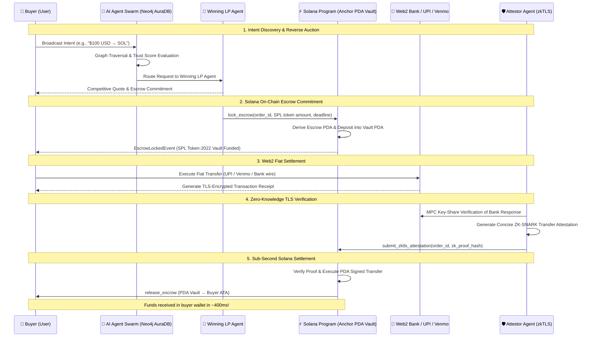
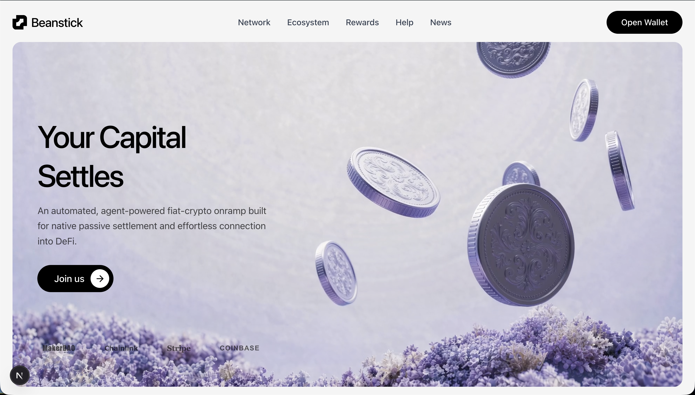
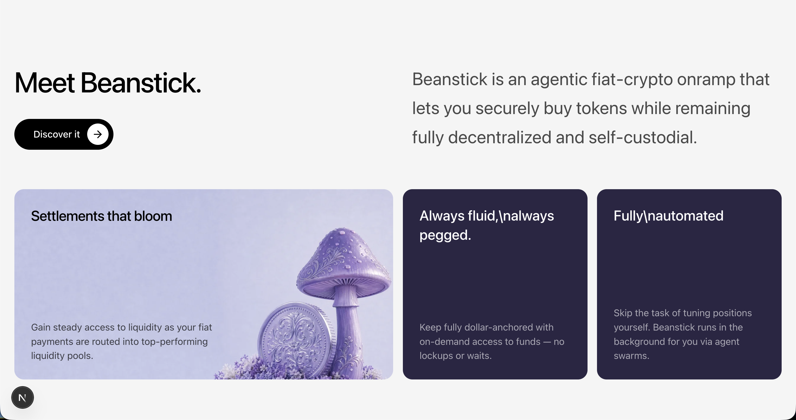
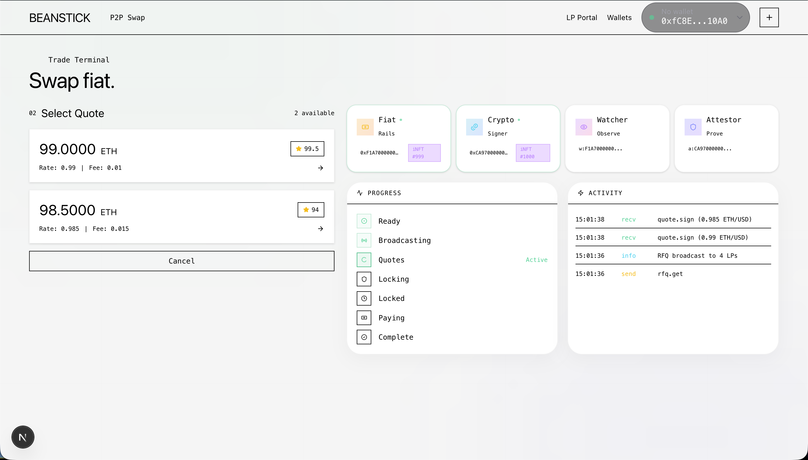

# 🚀 Beanstick (BeanSol)

> **The Autonomous Fiat-to-Crypto Settlement Network on Solana.**  
> Sub-second finality. Zero custodians. No centralized exchanges.

[](https://solana.com)
[](https://www.anchor-lang.com/)
[](https://www.rust-lang.org)
[](https://www.typescriptlang.org)
[](https://nextjs.org)
[](https://www.mlh.com/events/solana-hackathon)

---

## 🏆 MLH Solana Hackathon 2026 Submission

Built for the **Major League Hacking (MLH) Solana Hackathon** (November 6–8, 2026). Beanstick harnesses Solana’s high-throughput architecture, micro-penny transaction fees, and sub-second finality to create a friction-free, non-custodial fiat-to-crypto onramp.

### Targeted Prize Tracks:

* 🥇 **Top 3 Overall Track ($1,000 Microgrant)**
  * A production-ready, working product engineered specifically around Solana's strengths: 400ms block times, negligible fees, composable Program Derived Addresses (PDAs), and SPL Token-2022 standards. Beanstick replaces slow, custodial Web2 fiat onramps with trustless, instant peer-to-peer settlement.

* 🤖 **AI Track Top Prize ($100 Digital Gift Card)**
  * Powered by an autonomous **Agentic Swarm Protocol**. Autonomous Liquidity Provider (LP) AI agents hold dedicated Solana keypairs, analyze order intents in real-time, execute sub-millisecond reverse auctions, and settle trades on-chain. Features conversational intent parsing (*"swap 100 USD to SOL"*), graph-based reputation routing, and verifiable zkTLS attestations.

* ⚡ **DeFi Track Top Prize ($100 Digital Gift Card)**
  * A next-generation decentralized finance protocol enabling trustless fiat-to-crypto settlement. Features an Anchor-based escrow state machine, PDA token vaults supporting native **`SOL`**, **`USDC (SPL)`**, and **`PYUSD (SPL)`**, cryptographic bank receipt verification, and zero counterparty risk.

---

## 📌 The Problem

Moving value between traditional banking (Web2) and decentralized finance (Web3) is fundamentally broken:
* **Centralized Gatekeepers & Custodians:** Centralized exchanges hold customer funds and impose multi-day withdrawal locks.
* **Exorbitant Fees:** Traditional onramps charge 3% to 8% in hidden spreads and processing fees.
* **Slow Settlement:** Bank transfers take hours or days to credit on Layer 1 EVM blockchains due to gas constraints and slow block times.
* **Counterparty Risk:** Traditional P2P trading relies on human escrow operators or flawed manual dispute resolution.

---

## 🎯 The Solution: Beanstick on Solana

Beanstick replaces centralized middlemen with a decentralized network of autonomous AI Liquidity Provider (LP) agents coordinated on Solana.

* ⚡ **Solana-Native Speed:** Transactions settle in ~400ms with sub-cent network fees, enabling true real-time checkout flows for fiat-to-crypto swaps.
* 🤖 **Autonomous AI LP Swarm:** Independent LP agents compete in automated reverse auctions to offer buyers the best rates with minimal spread.
* 🔒 **Non-Custodial PDA Escrows:** Funds are locked in deterministic Program Derived Address (PDA) vaults governed strictly by an on-chain finite-state machine (FSM).
* 🛡️ **zkTLS Cryptographic Verification:** Web2 bank transfers (UPI, Venmo, SEPA, Bank transfer) are verified privately using Multi-Party Computation (MPC) and ZK-SNARK proofs—no sensitive banking credentials are ever revealed on-chain.

---

## 🧠 Architecture & End-to-End Workflow



---

## 🛠️ Solana On-Chain Program Architecture

The core protocol is implemented in **Rust** using the **Anchor framework** located in [`programs/beanstick`](file:///Users/ayush/Desktop/beansol/programs/beanstick):

* **`initialize_config`:** Initializes global protocol parameters, treasury accounts, and operational fee configurations.
* **`register_lp`:** Onboards and registers an AI Liquidity Provider agent with on-chain metadata and AXL communications public key.
* **`lock_escrow`:** Derives canonical Escrow and Vault PDAs, transferring tokens from the LP's Associated Token Account (ATA) into the secure program-controlled vault.
* **`submit_zktls_attestation`:** Records verifiable cryptographic proof hashes generated by off-chain zkTLS attestors.
* **`release_escrow`:** Trustlessly releases vault funds directly to the buyer's ATA using PDA signing seeds upon successful verification.
* **`refund_escrow`:** Safeguards LP capital by returning vault funds if the settlement deadline elapses without verified fiat proof.
* **`commit_reputation_root`:** Periodically anchors Merkle roots of agent graph trust scores calculated by the Neo4j AuraDB engine on Solana.

### Canonical PDA Derivation Scheme:

| Account | Seeds | Description |
| :--- | :--- | :--- |
| **Protocol Config** | `["protocol-config"]` | Global configuration and protocol authority |
| **LP Account** | `["lp-account", lp_authority.key()]` | LP Agent registry & performance state |
| **Escrow Account** | `["escrow", order_id.to_le_bytes()]` | Order state, amounts, deadlines, and hashes |
| **Escrow Vault** | `["escrow-vault", escrow_pda.key()]` | Program-owned SPL Token PDA holding collateral |
| **Attestation** | `["attestation", escrow_pda.key()]` | Cryptographic zkTLS verification state |
| **Reputation Root** | `["reputation-root", epoch.to_le_bytes()]` | On-chain Merkle root of graph trust scores |

---

## 💻 Tech Stack

### ⚡ Solana & Web3
* **Solana Programs:** Rust, Anchor Framework `0.30.1`
* **Solana SDK:** `@solana/web3.js` `1.95.0`, `@solana/spl-token` `0.4.8`, `@coral-xyz/anchor` `0.30.1`
* **Supported Tokens:** Native **`SOL`**, **`USDC`** (SPL Token-2022), **`PYUSD`** (PayPal USD on Solana)
* **Optimization:** Compute Budget priority fees (`setComputeUnitPrice`, `setComputeUnitLimit`) and Address Lookup Tables (ALTs)

### 🤖 AI Swarm & Intelligence Layer
* **Agentic Framework:** Node.js, AXL protocol peer-to-peer messaging
* **Graph Intelligence:** **Neo4j AuraDB** (PageRank, Betweenness Centrality, and trust score routing)
* **Off-Chain Verification:** zkTLS (Multi-party computation TLS session verification + ZK-SNARK proofs)

### 🖥️ Frontend & User Experience
* **Framework:** Next.js 16 (App Router), React 19, TypeScript
* **Styling & Animation:** Tailwind CSS v4, Framer Motion, Lucide Icons
* **UI Features:** Conversational AI trade command bar, real-time liquidity auction visualizer, QR commitment generators

---

## 📸 Interface Preview

<div align="center">
  
  <br/><br/>
  
  <br/><br/>
  
</div>

---

## 📂 Repository Directory Layout

```
beansol/
├── programs/
│   └── beanstick/               # Native Solana Anchor Program
│       ├── Cargo.toml
│       ├── Anchor.toml
│       └── src/
│           ├── lib.rs           # Program entrypoint & instruction routes
│           ├── instructions/    # lock_escrow, release_escrow, register_lp, etc.
│           ├── state/           # PDA account structures & state definitions
│           ├── errors.rs        # Custom protocol error codes
│           └── events.rs        # On-chain event declarations
├── packages/
│   └── solana-client/           # Production TypeScript SDK for Solana
│       ├── package.json
│       └── src/
│           ├── index.ts         # BeanstickSolanaClient & versioned tx builder
│           └── pda.ts           # Canonical PDA address derivation helpers
├── agents/                      # Autonomous AI Swarm Agents
│   ├── crypto-agent/            # Solana liquidity & quoting agent
│   ├── fiat-agent/              # Web2 banking webhook listener
│   └── runtime/                 # Base agent loop & decision logging
├── services/
│   ├── agent-server/            # Real-time agent pair coordination server
│   └── trust-infrastructure/    # Neo4j AuraDB reputation graph & sync service
├── apps/
│   └── web/                     # Next.js 16 P2P Trading Terminal & AI Chat
│       ├── src/app/p2p/         # Interactive swap terminal (SOL, USDC, PYUSD)
│       └── src/components/      # Blur reveals, grid overlays, live metrics
└── tests/
    └── solana/                  # Solana Anchor integration & PDA tests
```

---

## 🚀 Getting Started

### Prerequisites

* [Node.js](https://nodejs.org/) (v18 or higher)
* [pnpm](https://pnpm.io/) (`corepack enable pnpm`)
* [Rust](https://www.rust-lang.org/tools/install) & [Solana CLI](https://docs.solanalabs.com/cli/install) (`solana-cli 1.18+`)
* [Anchor CLI](https://www.anchor-lang.com/docs/installation) (`anchor-cli 0.30.1`)

### 1. Clone & Install Dependencies

```bash
git clone https://github.com/ayushkumar2601/sol_bean.git
cd sol_bean

# Install workspace dependencies
pnpm install
```

### 2. Configure Environment

Create a `.env` file in the project root:

```bash
cp .env.example .env
```

Ensure your Neo4j AuraDB credentials and agent keys are filled in.

### 3. Build & Test Solana Program

```bash
# Build the Anchor program
cd programs/beanstick
anchor build

# Test PDA derivations and SDK client
cd ../..
npx tsx tests/solana/beanstick.test.ts
```

### 4. Run the Full Stack

Launch the Web UI, Agent Server, and Webhook Receiver simultaneously:

```bash
chmod +x start-all.sh
./start-all.sh
```

* **Web Trading Terminal:** [http://localhost:3000/p2p](http://localhost:3000/p2p)
* **Agent Server:** `http://localhost:4002`
* **Payment Webhook:** `http://localhost:4001`

---

## 👥 Team

Built with ❤️ by **Ayush Kumar** for the **MLH Solana Hackathon 2026**.

* **GitHub:** [@ayushkumar2601](https://github.com/ayushkumar2601)
* **LinkedIn:** [Ayush Kumar](https://www.linkedin.com/in/ayush-kumar-9003b5321/)

---

## 📄 License

This project is licensed under the MIT License.
